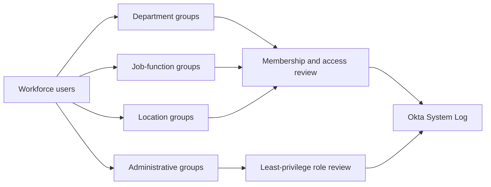

# 01 — Okta Organization & Group Architecture

## Project summary

I designed a group model for the simulated TechMigos workforce in an Okta Identity Engine tenant. The lab covers how users are organized by department, job function, location, and administrative responsibility, and how group membership can be reviewed and audited.

This is a lab implementation. The evidence below describes what I configured and observed; proposed production controls and unverified test cases are labeled separately.

## Business problem

A growing organization needs groups that are understandable, maintainable, and safe to use in access decisions. Poorly governed groups can accumulate manual exceptions, duplicate access, or grant administrative privileges too broadly.

The goal of this project was to establish a readable group structure, compare manual and rule-managed membership, review administrator-role options, and inspect Okta audit activity.

## Architecture

The layers serve different purposes:

- **Department groups** describe organizational ownership, such as Finance, Marketing, and HR.
- **Job-function groups** describe work responsibilities, such as Help Support, Cloud Professionals, and CyberOps.
- **Location groups** identify office-based populations, such as New York Office.
- **Administrative groups and roles** separate privileged administration from workforce access.

The model keeps group purpose explicit so a reviewer can understand why a user belongs to a group before using it in an application or policy assignment.

## Group model

| Group layer | Examples from the lab | Intended use |
|---|---|---|
| Department | TechMigos Finance Group, Marketing Group, HR Group | Organize access and review by business department |
| Job function | Help Support, Cloud Professionals, CyberOps | Represent role or operational responsibilities |
| Location | New York Office | Identify users associated with an office location |
| Administration | TechMigos Administrators, Okta Admins | Separate privileged administration from workforce groups |

### Membership model

I used both manual membership and a Finance Group Rule. The Finance membership evidence shows four active users and a mix of rule-managed and manually assigned members.

That demonstrates both assignment methods, while also surfacing a governance question: manual additions to a rule-managed group can create exceptions that are harder to explain later. Before production use, I would document the exact rule expression, identify the authoritative profile attribute, and define who can approve and review exceptions.

## Implementation

1. I activated and reviewed the Okta Identity Engine tenant.
2. I reviewed the Directory, Security, Reports, and System Log areas.
3. I created department, job-function, location, and administrative groups with descriptions.
4. I added test users to the Finance group through rule-managed and manual membership.
5. I reviewed the resulting group membership.
6. I compared standard administrator roles with custom administrator roles and created custom roles for limited responsibilities.
7. I filtered the System Log for successful events.

## Validation record

| Check | Evidence and observed result | What it establishes |
|---|---|---|
| Group inventory | The directory screenshot shows groups, descriptions, people counts, and application counts. | The tenant contains a documented group structure. |
| Finance membership | The Finance group screenshot shows four active users and rule-managed plus manual membership. | Both membership methods were used and the resulting membership was reviewed. |
| Administrator roles | Screenshots show standard and custom administrator-role options; custom roles were created. | The available role model was reviewed and narrower role definitions were configured. |
| System Log | The screenshot shows a filtered timeline of successful events. | Audit events can be found and reviewed in the tenant. |

## Evidence

### Group directory

**Evidence:** Group names, descriptions, and directory counts.

### Finance group membership

**Evidence:** Four active Finance users and a combination of rule-managed and manual membership.

### Standard administrator roles

**Evidence:** Review of Okta's built-in administrator roles.

### Custom administrator roles

**Evidence:** Custom role definitions for more limited administrative responsibilities.

### System Log overview

**Evidence:** A filtered view of successful audit activity. The screenshot is an overview; it does not show the full details of a specific event.

## Remaining validation

These checks are the next lab steps. They are not represented as completed in the current evidence.

| Scenario | Expected result | Evidence to capture |
|---|---|---|
| Finance joiner | A user whose authoritative department attribute matches the Finance rule is added to the Finance group. | Rule expression, test user's relevant attribute, and resulting membership |
| Department mover | Changing a user's department removes the old rule-based membership and grants the new one. | Before-and-after profile, group membership, and relevant System Log events |
| Manual exception | A manually added member is identifiable as an exception and has an owner or approval record. | Membership source, approval record, and review date |
| Delegated administrator | A named test administrator receives only the intended custom role and can perform its approved tasks. | Assigned administrator, role, permitted task, and denied out-of-scope task |
| Audit detail | A relevant change event records the actor, target, event type, timestamp, and outcome. | Redacted event-detail view |

## Production design recommendations

- Use a consistent naming convention that identifies group purpose and scope.
- Make an authoritative user-profile attribute the source for rule-managed membership.
- Assign an owner and review date to each access-bearing group.
- Keep manual exceptions documented, approved, and periodically reviewed.
- Test both allowed and denied administrative actions before delegating a role.
- Review detailed System Log events for access changes and administrator activity.
- Avoid assigning application access to broad groups until membership and ownership are validated.

## What I learned

The group directory is only the start of group architecture. A stronger design connects each group's purpose to a membership source, an owner, an access decision, and a testable review process. This lab established the group categories and demonstrated manual and rule-managed membership; the remaining validation table identifies the evidence needed to show the full lifecycle and least-privilege behavior.
