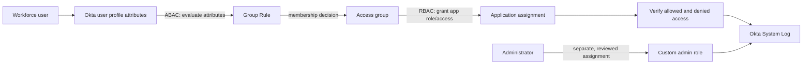

# 01 — Okta Organization & Group Architecture

## Project summary

I designed a group model for the simulated TechMigos workforce in an Okta Identity Engine tenant. The lab covers how users are organized by department, job function, location, and administrative responsibility, and how group membership can support governed application access.

This is a lab implementation. The evidence below distinguishes work I configured and observed from RBAC and ABAC validation that still needs to be captured.

## Business problem

A growing organization needs groups that are understandable, maintainable, and safe to use in access decisions. Group membership should follow a defined source of truth, application access should match job responsibilities, and administrative privileges should remain separately controlled.

## Architecture



- **ABAC:** User attributes, such as department, are evaluated to determine group membership or another access decision.
- **RBAC:** A role or access group grants a defined set of application permissions.
- **Combined flow:** Attribute-based membership can place a user in an access group; that group can then be assigned to an app or app role.
- **Administrative access:** Admin roles use a separate, reviewed assignment path. Okta Group Rules can't assign users to admin groups.

## Group model

| Group layer | Examples from the lab | Intended use |
|---|---|---|
| Department | TechMigos Finance Group, Marketing Group, HR Group | Organize access and review by business department |
| Job function | Help Support, Cloud Professionals, CyberOps | Represent role or operational responsibilities |
| Location | New York Office | Identify users associated with an office location |
| Administration | TechMigos Administrators, Okta Admins | Separate privileged administration from workforce groups |

## RBAC and ABAC design

### ABAC: attribute-driven membership

I configured a Finance Group Rule and reviewed Finance membership. The existing screenshot shows four active users and a mix of rule-managed and manually assigned members. The current evidence does not show the rule expression or the profile attribute that drove the rule.

A test rule might use an expression like:

```text
user.department == "Finance"
```

This is an example only. I will document the actual expression and use the exact attribute name and value configured in my tenant.

### RBAC: group-to-application access

To demonstrate RBAC end to end, I will assign an access group to a test app and capture the app role or entitlement when the integration supports it. The group membership evidence alone does not prove application access was granted.

### Combined test scenario

1. Set a test user's source profile attribute to Finance.
2. Confirm the Group Rule evaluates and places the user in the Finance access group.
3. Assign the Finance access group to a test application with the intended role or entitlement.
4. Verify that the Finance user receives the expected access.
5. Test an HR user and verify that the user does not receive Finance group membership or Finance app access.
6. Change a test user's department and verify that old access is removed and new access is granted.

These end-to-end tests are planned and are not claimed as completed in the current evidence.

## Administrative access

I reviewed standard and custom administrator roles and created custom role definitions for limited responsibilities. To complete the evidence, I still need to show a named test administrator assigned to a custom role and validate both an allowed action and an out-of-scope action.

Group Rules can't be used to assign users to admin groups, so I keep this path separate from attribute-driven workforce access.

## Implementation completed

1. I activated and reviewed the Okta Identity Engine tenant.
2. I reviewed the Directory, Security, Reports, and System Log areas.
3. I created department, job-function, location, and administrative groups with descriptions.
4. I used both rule-managed and manual membership in the Finance group.
5. I reviewed the resulting Finance group membership.
6. I compared standard administrator roles with custom administrator roles and created custom role definitions.
7. I filtered the System Log for successful events.

## Validation record

| Check | Evidence and observed result | Status |
|---|---|---|
| Group inventory | The directory screenshot shows groups, descriptions, people counts, and application counts. | Captured |
| Finance membership | The Finance group screenshot shows four active users and rule-managed plus manual membership. | Captured |
| Administrator role definitions | Screenshots show standard and custom administrator-role options; custom roles were created. | Captured |
| System Log overview | The screenshot shows a filtered timeline of successful events. | Captured |
| ABAC rule logic | Exact expression, target group, and attribute source are not shown in current evidence. | To capture |
| RBAC app assignment | Group-to-app assignment and app role or entitlement are not shown in current evidence. | To capture |
| Access decision | Positive Finance and negative HR access results are not shown in current evidence. | To test |
| Admin assignment | A named admin assigned to the custom role and tested against its scope is not shown. | To capture |
| Detailed audit event | A specific event's actor, target, type, timestamp, and outcome are not shown. | To capture |

## Existing evidence

### Group directory


**Evidence:** Group names, descriptions, and directory counts.

### Finance group membership


**Evidence:** Four active Finance users and a combination of rule-managed and manual membership.

### Standard administrator roles


**Evidence:** Review of Okta's built-in administrator roles.

### Custom administrator roles


**Evidence:** Custom role definitions for more limited administrative responsibilities.

### System Log overview


**Evidence:** A filtered view of successful audit activity. The screenshot is an overview; it does not show the full details of a specific event.

## RBAC

I understand RBAC as giving access based on a user's role. In my Okta lab, a group can represent that role and be assigned to an app. I reviewed admin roles and created custom role definitions; I still need to capture the group-to-app assignment and show the access it gives.

<!-- Paste the RBAC screenshot here. -->

## ABAC

I understand ABAC as using details about a user, such as their department, to decide what access they should receive. I configured a Finance Group Rule and reviewed the members, but I still need to capture the exact rule condition and the profile attribute it uses.

<!-- Paste the ABAC screenshot here. -->
