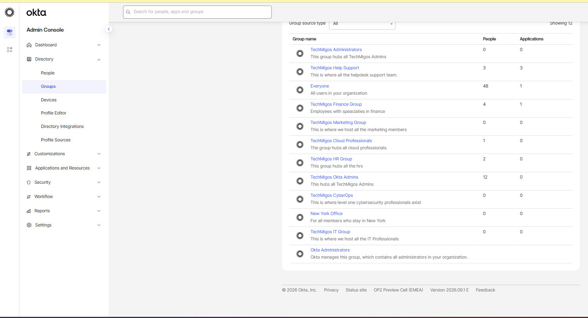
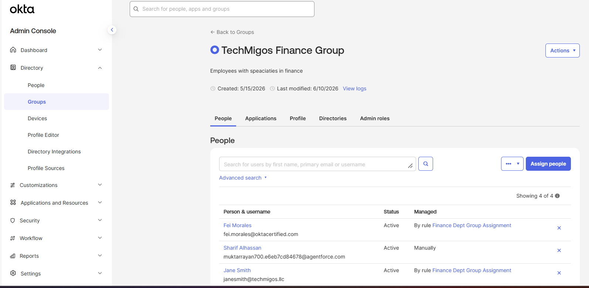
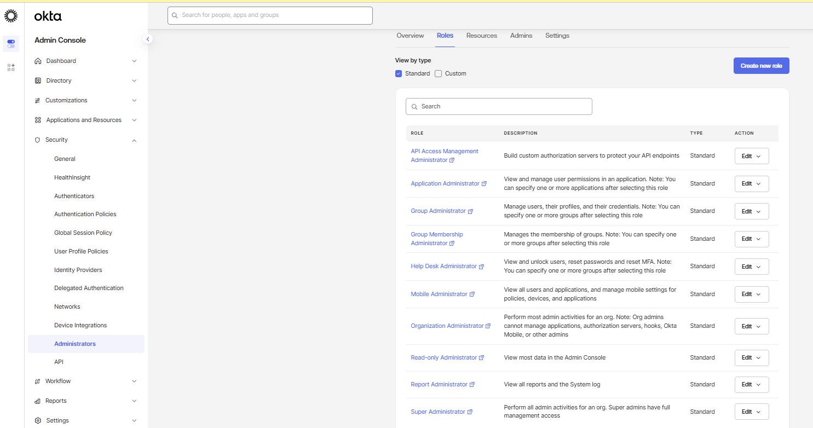
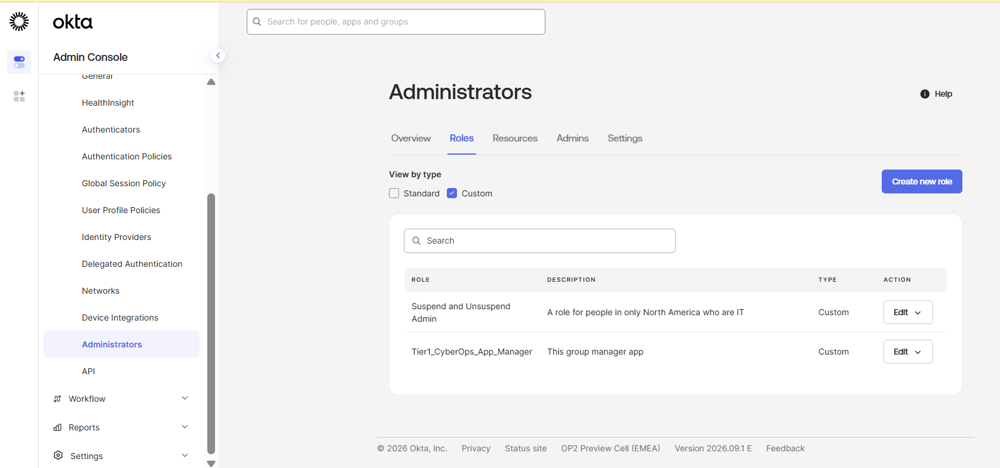
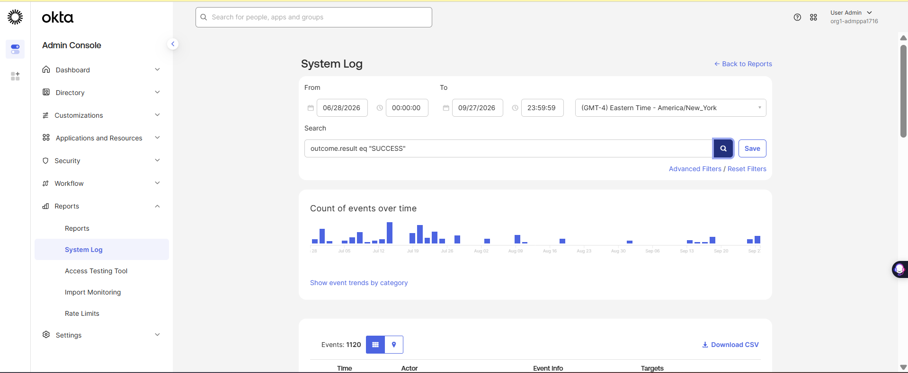

# Evidence — Okta Organization & Group Architecture

These are the screenshots I captured while working in my Okta practice tenant.

## Screenshots I already have

### Group directory

I used this to review the groups I created.

### Finance group members

This shows four active users in Finance, with rule-managed and manual membership.

### Standard admin roles

I reviewed the built-in admin role options.

### Custom admin roles

I created and reviewed custom role definitions. I haven't added a test administrator to one yet.

### System Log

This is my filtered overview of successful events. I still need to capture the details of one specific event.

## Screenshots I'm adding next

### Finance user attribute and Group Rule

<!-- Paste the screenshot here. -->

### Finance group membership after the rule runs

<!-- Paste the screenshot here. -->

### Finance group assigned to a test app

<!-- Paste the screenshot here. -->

### Finance access works and HR access is denied

<!-- Paste the screenshot here. -->

### Test administrator assigned to a custom role

<!-- Paste the screenshot here. -->

### Detailed System Log event

<!-- Paste the screenshot here. -->

Before I share a screenshot, I remove personal details, IP addresses, session data, tokens, and secrets.
